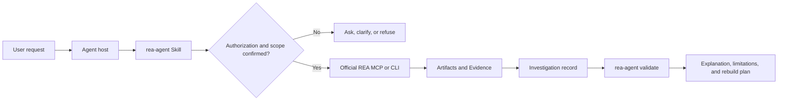

# REA Agent

[](https://github.com/jahonn/rea-agent/actions/workflows/ci.yml)
[](LICENSE)
[](package.json)

A portable, evidence-first reverse engineering agent workflow for **Claude Code, Codex, dsh, and WorkBuddy**, powered by the separate [REA](https://github.com/morluto/rea) toolchain.

REA Agent is not another model runtime. It combines an open Agent Skill, a Claude Code subagent, a safety-conscious installer, environment diagnostics, and a machine-readable investigation contract. Existing agent hosts keep their own model, planning loop, permissions, and user interface.

> Independent community project. REA Agent is not affiliated with or endorsed by the REA maintainers. No REA source code is vendored.

## Why this project

Prompt-only agents are difficult to install, test, and audit. REA Agent turns the workflow into a small engineering project with:

- **Portable behavior**: one `SKILL.md` works across supported agent hosts.
- **Isolated delegation**: Claude Code can run the workflow as a named subagent.
- **Evidence discipline**: every finding requires evidence, confidence, limitations, and unknowns.
- **Authorization gate**: target inspection starts only after explicit scope and risk confirmation.
- **Safe installation**: dry run by default, no overwrite, and no automatic MCP changes.
- **Machine-checkable reports**: JSON Schema plus a zero-dependency CLI validator.
- **Reproducible engineering**: Node.js built-ins, unit and CLI tests, and GitHub Actions CI.

## Architecture



The CLI manages the workflow and its contracts. It does not invoke a model, bypass the host's permission system, or run target analysis itself.

## Requirements

- Node.js 22 or newer for the REA Agent CLI.
- npm for the official REA installer.
- A supported current REA runtime for analysis: Node.js **22.23.4+**, **24.22.1+**, or **26.12.1+**.
- An agent host that supports Agent Skills and/or local MCP servers.
- Optional native analysis providers, subject to their own licenses and REA's documentation.

Run the side-effect-free readiness check:

```bash
node bin/rea-agent.mjs doctor
# or, after npm link:
rea-agent doctor --json
```

The command never downloads REA. A missing or unsupported dependency produces a recommendation instead of an automatic installation.

## Quick start

```bash
git clone https://github.com/jahonn/rea-agent.git
cd rea-agent
npm ci
npm test
npm run check
```

Preview a project-level Claude Code installation:

```bash
node bin/rea-agent.mjs install --target claude --scope project
```

Apply only after reviewing the destination list:

```bash
node bin/rea-agent.mjs install --target claude --scope project --apply
```

Install the official REA toolchain and MCP registration separately:

```bash
npx rea-agents setup
```

Review the official installer's proposed changes, restart the agent host, and then request a narrowly scoped investigation.

## Host installation

| Host | Skill destination | Named agent |
|---|---|---|
| Claude Code | `.claude/skills/rea-agent/` | `.claude/agents/rea-agent.md` |
| Codex | `.agents/skills/rea-agent/` | Host-managed workflow |
| dsh | `.agents/skills/rea-agent/` | Host-managed workflow |
| WorkBuddy | `.workbuddy/skills/rea-agent/` | Host-managed workflow |

For user-scope installation, select `--scope user`. The CLI chooses the corresponding directory under your home folder. Codex and dsh share the `.agents` skill path; `--target all` deduplicates that operation.

Examples:

```bash
# Preview every supported host for the current project
node bin/rea-agent.mjs install --target all --scope project

# Install only the shared Codex/dsh skill under a staging directory
node bin/rea-agent.mjs install --target codex --scope user --root ./staging --apply

# Install for WorkBuddy in the current project
node bin/rea-agent.mjs install --target workbuddy --scope project --apply
```

Existing destinations cause the entire installation to stop before writing. The installer does not merge `AGENTS.md`, edit MCP configuration, or modify existing agent settings. Optional manual snippets are provided under `adapters/`.

## Use the agent

After REA setup and host restart, ask:

```text
Use rea-agent to investigate how settings synchronization works in my own
Electron application at /absolute/path/to/app. Explain the relevant modules
and IPC flow, provide evidence and limitations, and do not run the application.
```

For an independent implementation:

```text
Based on the authorized evidence, implement equivalent settings synchronization
behavior in my project. Define observable inputs and outputs, add behavioral
tests, and label any assumption that was not verified against the reference.
```

The agent must first establish target authority, purpose, output scope, and risk acknowledgement. Runtime capture always requires separate confirmation.

## Investigation records

Create a pending record without running analysis:

```bash
node bin/rea-agent.mjs init investigation.json
```

Fill in the target and authorization fields, then add findings using the confidence levels `observed`, `inferred`, or `speculative`. Every finding must reference at least one evidence item.

```bash
node bin/rea-agent.mjs validate investigation.json
node bin/rea-agent.mjs validate investigation.json --require-authorized
```

The schema is available at [`schemas/investigation-record.schema.json`](schemas/investigation-record.schema.json), with synthetic examples under [`examples/`](examples/).

Validation checks structure and completeness. It cannot verify legal authority, claim accuracy, artifact provenance, or runtime equivalence.

## CLI reference

```text
rea-agent doctor [--json]
rea-agent install [--target all|claude|codex|dsh|workbuddy]
                  [--scope project|user] [--root <directory>] [--apply]
rea-agent init [report.json]
rea-agent validate <report.json> [--require-authorized]
rea-agent --version
```

Exit status is non-zero for invalid reports, failed installation, or an environment that is not ready for REA analysis.

## Project layout

```text
adapters/                 Host-specific subagent and instruction snippets
bin/                      Executable entry point
docs/                     Architecture and design notes
examples/                 Synthetic investigation records
schemas/                  Portable JSON Schema
skills/rea-agent/         Host-independent workflow and resources
src/                      Zero-dependency CLI modules
test/                     Unit and end-to-end CLI tests
.github/workflows/        Continuous integration
```

## Engineering notes

- **Zero runtime dependencies** reduce supply-chain exposure and make the CLI easy to audit.
- **Dry-run-first installation** keeps user configuration under user control.
- **No automatic REA execution** keeps the authorization boundary visible to the host and user.
- **Schema and validator are complementary**: the schema supports external tooling; the validator provides a dependency-free local check.
- **Explicit uncertainty** prevents partial static analysis from being presented as complete behavioral knowledge.

See [docs/ARCHITECTURE.md](docs/ARCHITECTURE.md) for trust boundaries and design decisions.

## Roadmap

- Add fixture-based report quality tests and schema compatibility checks.
- Add update planning with non-destructive backup and rollback.
- Add more host adapters through community contributions.
- Add optional behavioral-test scaffolding for independently rebuilt features.

## Security and responsible use

Read [SECURITY.md](SECURITY.md) before analyzing a real target. Do not use this project for unauthorized access, DRM or license bypass, trade-secret theft, or infringing distribution. Commercial analysis tools require valid licenses.

## Contributing

See [CONTRIBUTING.md](CONTRIBUTING.md). Bug reports should use synthetic or owned fixtures and must not include proprietary binaries, credentials, or confidential target output.

## Development and ownership

The initial design and implementation were AI-assisted. The repository owner is responsible for review, releases, security response, and ongoing maintenance. Contributors and users should evaluate the code and workflow before production use.

## License

[MIT](LICENSE). REA is a separate MIT-licensed project; third-party tools retain their own licenses. See [NOTICE](NOTICE).
